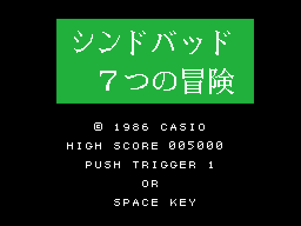
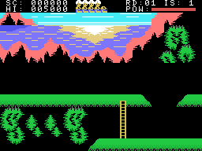
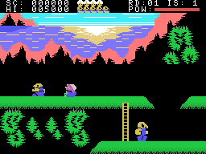
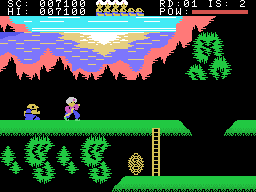
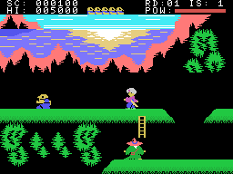

# The game

*Shindobaddo Nanatsu no Bouken* (シンドバッド７つの冒険, "Sindbad's seven adventures") is a platform game: Sindbad
walks over platforms joined by ladders, knocks his enemies down with his scimitar and, when the island opens,
looks for the way out; a giant bird carries him from island to island. There are seven islands, in
[The islands](THE-ISLANDS.html).

Every GIF on this site is the ROM **running in openMSX** (a Japanese MSX1 with C-BIOS, at 60 frames per second):
on every frame the VRAM, the RAM and the VDP registers are logged, and `tools/vdp.py` paints them.

## The intro and the title

At power-on, four CASIO logos come in from the sides, the top and the bottom and meet in the middle; then the
CASIO sound (`presentacion`, 0x454D). The button or the end of the sound lead to the title: the name in kana and
kanji on a green box, © 1986 CASIO, the high score and PUSH TRIGGER 1 OR SPACE KEY (`titulo`, 0x471F). With no
button for 256 frames, the **demo** starts (`titulo_espera`, 0x47AC). The demo does not play by time but by
**places**: its list (0x41CB) says which column Sindbad has to walk to and what he does when he gets there.

## The controls

| | joystick | keyboard |
|---|---|---|
| walk, climb and go down ladders, crouch | joystick 1 | the cursor keys |
| scimitar | button 1 | the space bar |
| somersault | button 2 | GRAPH |

Sindbad walks one column at a time and, on a ladder (tile 0x26), goes up or down one row every 4 frames
(`prota_escalera`, 0x5E3C). Down with no ladder below, he **crouches** (`palanca_abajo`, 0x5ADE).

The **scimitar** (button 1) is three drawings of 3 frames; the enemies in his row, from 1 to 4 columns in front,
fall (`prota_espada`, 0x5B0A; `coge`, 0x5B81). If it hits one of the blue posts, it clangs and stops.

The **somersault** (button 2) is an arc of seven steps of 4 frames, up four rows and down again, one or two
columns towards the side of the joystick at every step, or straight up (`prota_brinco`, 0x5C6A, with the heights at
0x5CF2). The enemies it touches in the air fall too (`toca_cosas`, 0x5CF9).

## The power, the falls and the lives

The **power** (POW, 0xEAD7) is 14 at the start of every island, and the bar at the top right shows half of it. An
enemy that touches Sindbad throws him back and takes one or two points (`enemigos_toca`, 0x60AC); with no power
left, he dies. The **shots** of the big enemy, a plant (`grande`, 0x6F61; `tiro`, 0x791D), freeze him and throw
him up into the air, and the fall usually kills him; crouching, a shot in his own row misses.

**Falls are deadly**: walking off a platform he falls one row every 4 frames, and when he lands on the ground below,
or reaches the bottom of the screen, he dies (`prota_cae`, 0x5F13; `prota_muere`, 0x5D2F). The **red pools** on
the platforms (tiles 0x28 and 0x29) trap him: he is stuck for a while and falls (`prota_atrapado`, 0x5D5E).

The game starts with **five lives** (`partida_borra`, 0x40E8); the heads at the top are the spare ones. With none
left, **GAME OVER** (`game_over`, 0x4AB6). Every round of the seven islands gives one more, up to seven
(`vuelta_siguiente`, 0x5861).

## The points

They are added in BCD with an extra 0 on the screen (`puntos_suma`, 0x42B4; `coge_si`, 0x5BBD):

- Each of the three small enemies, **100**.
- Each of the three that open the island, **250**.
- The big one, **500**; the object that brings out the way out, **500**.
- At the end of the island, **500** for every point of power left (`isla_cuenta`, 0x5812).

The high score starts at **5,000** (`partida_pon`, 0x4090). The demo does not add points.
