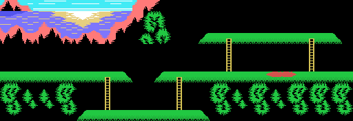
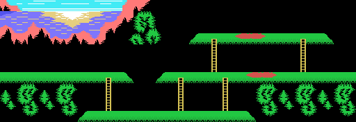
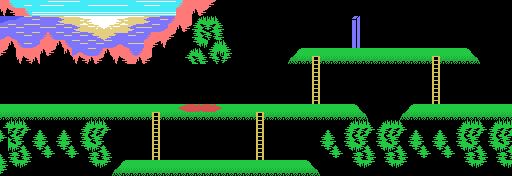
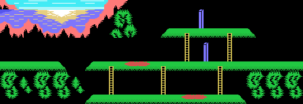
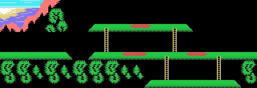
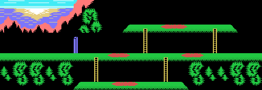
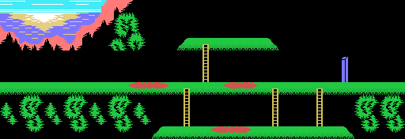
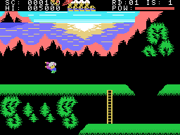
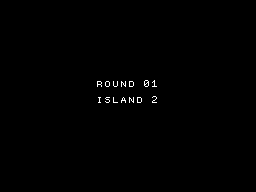

# The islands

Seven islands, in order, and after the seventh the first one of the next round. Each island is **64 columns
wide**, two screens: the game builds it whole in RAM and the screen shows 32 columns of it.

## The seven islands, whole

They are not screenshots: they are the RAM the game builds for each island (0xE01A, 24 rows of 64 tiles), as it
is two frames after it is built, before anything moves, painted with the tiles and colours of the VRAM of that
same frame; the 32 columns on the screen at that moment match the name table tile for tile (`tools/mapas.py`).
Sindbad and the bird are sprites and do not show. The recording starts at island 7 with keys 2 and 3 held at
power-on ([Curiosities](CURIOSITIES.html)); the other six are **forced** by the script, which writes the next
island where the game writes it.

## How an island is built

`isla_pon` (0x4B21) unpacks the tiles and colours, fills the 0x600 bytes of the island with blanks and lays the
pieces from the island's lists, each list with one block per island ended by a 0 (`lista_isla`, 0x4D6A):

- the **cliff and the sea** at the top: eight rows of a 32-column drawing (0x54F7), cut at a different column on
  every island (0x5496);
- the **platforms** (4 x 6 tiles, 0x55F7) and the **ladders** (3 x 6, 0x560F) of two lists;
- the two **holes** in the floors (0x5411, four bytes per island), with their edges;
- the long ladders (`columnas_pon`, 0x4D43) and the **blue posts** (`cosas4_pon`, 0x4D77), which stop the
  scimitar;
- the **red pools**, of 6 and 7 tiles (`cosas6_pon`, 0x4DF1; `cosas7_pon`, 0x4E21), and more gaps of 8 + 8
  tiles (`cosas8_pon`, 0x4DAE).

The view follows Sindbad one column at a time: when he gets within 12 columns of its left edge, or 20 of the right,
the game moves it (`bordes`, 0x42F5) and sends the 22 rows to the VRAM again (`fondo_pantalla`, 0x5645). On every
frame the objects are drawn as **tiles** in the island's RAM (`pinta_objeto`, 0x767B) and the 18 rows of the
middle go to the screen (`fondo_vram`, 0x4470); only Sindbad, the bird and the shot are sprites.

## The enemies

All of them are in one table of eight objects of 6 bytes (0xEB32), each with its class (its drawings and its
size):

| | how many | points | what it does |
|---|---|---|---|
| the first (0xEB32) | 1 | 500 | it appears when the island opens; felling it brings out the way out |
| the small ones (0xEB38) | 3 | 100 | they walk; where they cannot go on, they disappear (`enemigo_cae`, 0x6BC1) |
| the ones that open the island (0xEB4A) | 3 | 250 | they walk; one of them stays and runs away from Sindbad (`queda_huye`, 0x78A4) |
| the big one (0xEB5C) | 1 | 500 | a plant that shoots at him and every 120 frames jumps to another floor (`grande`, 0x6F61) |

The enemies that open the island have to be felled a number of times, which the status line shows as little
icons (0xEB29): **5** on island 1, **6** on island 2 and **7** on the others, in the first round. The data of the
enemies changes with the round: the first and the second have their own, and from the third on the third and the
fourth take turns (`vuelta_datos`, 0x6A17).

## The way out and the bird

When the count reaches 0 the island **opens** (0xE001 bit 0): the opening tune sounds and the first object
appears beside the view. Felling it brings out the **way out** (0xE001 bit 1): a tile 0x38 at the place of the
island's list (0x5488), or on island 7 a drawing of 3 x 3 tiles that changes every 16 frames (`marca_isla`,
0x5044). Touching it ends the island (`meta_mira`, 0x6076).

Then the giant bird comes down onto Sindbad, picks him up and flies away; the power left is counted, 500 points per
point, and the poster of the next island comes up with the bird carrying him; on the island, the bird comes down
and leaves him at column 8 (`pajaro_final`, 0x5768; `isla_cuenta`, 0x5812; `pajaro_se_lleva`, 0x56AB;
`pajaro_trae`, 0x56DF). In the recording below the way out is **forced**: no script fells all the enemies, so the
script writes 0xEAE4 = 0xFF, what Sindbad leaves when he touches the way out (0x60A0), and from there the game goes
on by itself.

