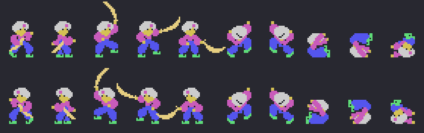
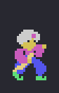
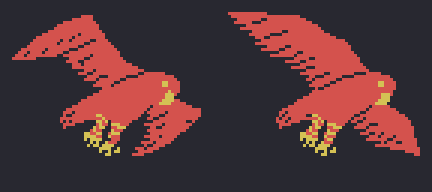
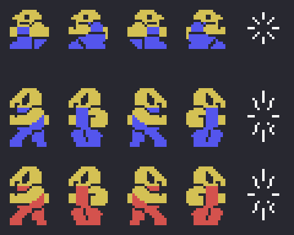

# The sprites

Everything on this page is **put together from the ROM**. *Shindobaddo* loads its sprite drawings at 0x1800 in
pieces, packed and with their mirror copies, and changes Sindbad's as he moves (`prota_dibujos` 0x61A0,
`prota_sprite` 0x61E7). So here `tools/hojas.py` **runs the game's own routines** with the Z80 of `tools/bios.py`:
`prota_pinta` (0x6279) with each drawing (0xEAE5) and each side (0xEADE), `pajaro_dibuja` (0x58EF) and
`enemigos_pon` (0x6981), and paints what they leave in the VRAM. None of these images is a screenshot.

**Checked against openMSX** on the six recordings of this site:

- Sindbad: with the drawing, the step and the side of each frame, the ROM run here gives the same six sprites as
  the game's copy (0xEB0B), and the drawings of those numbers in the recorded VRAM are the ones left here, on
  **17,021 frames, 0 different**; on 514 more the new drawing is not loaded yet, and on 5,010 the copy was made
  before the drawing or the side changed (on the bird and when a life is lost it is not even made again);
- the enemies' tiles 0x80-0xC7, drawings and colours, are **identical** on 22,205 frames of the first round
  (2,278 more, in the demo, still have the title's colours), **0 different**.

## Sindbad

Five sprites one on top of another and the scimitar, the sixth (`espada`, 0x6371, light yellow), in magenta, dark
blue, grey, dark yellow and light green. Top row facing one way, below the other: walking (the two steps, 0xEB0A),
the three drawings of the scimitar blow (1, 2 and 3), on a ladder (5, the two steps), bouncing back (7), falling (9)
and dead (10):

Walking, and the scimitar blow (three drawings of 3 frames), at the game's pace:

## The giant bird

It brings Sindbad to each island and takes him away (`pajaro_dibuja`, 0x58EF): four pieces of sprites (0x5958,
0x5961, 0x596A and 0x596F) and the body (`pajaro_cuerpo`, 0x599E), with the wings changing drawing every 4 frames
(0 or + 0x2C):

## The enemies are tiles

The enemies are **not sprites**: they are tiles that `pinta_objeto` (0x767B) copies onto the screen with their class
(IY): the walking drawing (+0, four: the step every 16 frames and the side), the falling one (+2), the size (+5)
and the columns (+6). Their tiles are loaded by `enemigos_pon` (0x6981) at 0x80 and onwards with their mirror
copies. Each row, one class: 0x6C92 (2 × 2), 0x6D7F and 0x6D88 (3 × 2, the same figure in two colours); the four
walking drawings and, last, the knocked-down one:

