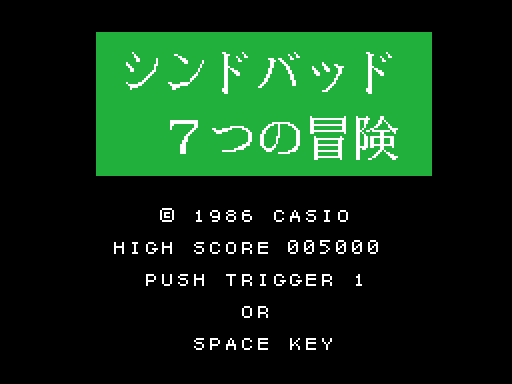
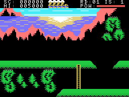
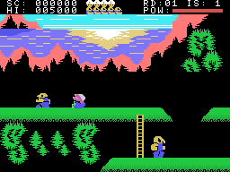
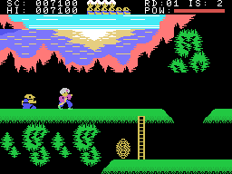
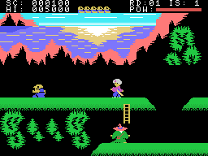

# La partida

*Shindobaddo Nanatsu no Bouken* (シンドバッド７つの冒険, "las siete aventuras de Simbad") es un juego de
plataformas: Simbad anda por plataformas unidas por escaleras, derriba a sus enemigos con el alfanje y, cuando la
isla se abre, busca la salida; un pájaro gigante lo lleva de isla en isla. Son siete islas, en
[Las islas](LAS-ISLAS.html).

Todos los GIF de esta web son la ROM **funcionando en openMSX** (un MSX1 japonés con C-BIOS, a 60 cuadros por
segundo): en cada cuadro se apuntan la VRAM, la RAM y los registros del VDP, y `tools/vdp.py` los pinta.

## La presentación y el título

Al encender, cuatro logotipos de CASIO entran por los lados, por arriba y por abajo y se juntan en el centro; luego
el sonido de CASIO (`presentacion`, 0x454D). El botón o el final del sonido llevan al título: el nombre en kana y
kanji sobre un recuadro verde, © 1986 CASIO, el récord y PUSH TRIGGER 1 OR SPACE KEY (`titulo`, 0x471F). Sin
botón durante 256 cuadros, empieza la **demostración** (`titulo_espera`, 0x47AC). La demostración no juega por
tiempo sino por **sitios**: su lista (0x41CB) dice a qué columna tiene que andar Simbad y qué hace al llegar.

## Los mandos

| | mando | teclado |
|---|---|---|
| andar, subir y bajar escaleras, agacharse | el mando 1 | los cursores |
| alfanje | el botón 1 | la barra |
| salto mortal | el botón 2 | GRAPH |

Simbad anda columna a columna y, en una escalera (la casilla 0x26), sube o baja una fila cada 4 cuadros
(`prota_escalera`, 0x5E3C). Abajo sin escalera debajo, se **agacha** (`palanca_abajo`, 0x5ADE).

El **alfanje** (el botón 1) son tres dibujos de 3 cuadros; los enemigos de su fila, de 1 a 4 columnas por delante,
caen (`prota_espada`, 0x5B0A; `coge`, 0x5B81). Si da en uno de los postes azules, choca y se acaba.

El **salto mortal** (el botón 2) es un arco de siete pasos de 4 cuadros, cuatro filas arriba y abajo otra vez, una
o dos columnas hacia el lado de la palanca en cada paso, o recto hacia arriba (`prota_brinco`, 0x5C6A, con las
alturas en 0x5CF2). Los enemigos que toca en el aire también caen (`toca_cosas`, 0x5CF9).

## La fuerza, las caídas y las vidas

La **fuerza** (POW, 0xEAD7) es 14 al empezar cada isla, y la barra de arriba a la derecha enseña la mitad. Un
enemigo que toca a Simbad lo echa hacia atrás y le quita uno o dos puntos (`enemigos_toca`, 0x60AC); sin fuerza,
muere. Los **tiros** del enemigo grande, una planta (`grande`, 0x6F61; `tiro`, 0x791D), lo dejan quieto y lo lanzan
por el aire, y la caída suele matarlo; agachado, un tiro de su misma fila no le da.

**Las caídas matan**: si sale de una plataforma, cae una fila cada 4 cuadros y, al llegar al suelo de abajo o al
fondo de la pantalla, muere (`prota_cae`, 0x5F13; `prota_muere`, 0x5D2F). Los **charcos rojos** de las
plataformas (las casillas 0x28 y 0x29) lo atrapan: se queda un rato quieto y cae (`prota_atrapado`, 0x5D5E).

La partida empieza con **cinco vidas** (`partida_borra`, 0x40E8); las cabezas de arriba son las de reserva. Sin
ninguna, **GAME OVER** (`game_over`, 0x4AB6). Cada vuelta a las siete islas da una más, hasta siete
(`vuelta_siguiente`, 0x5861).

## Los puntos

Se suman en BCD, con un 0 de más en la pantalla (`puntos_suma`, 0x42B4; `coge_si`, 0x5BBD):

- Cada uno de los tres enemigos pequeños, **100**.
- Cada uno de los tres que abren la isla, **250**.
- El grande, **500**; el objeto que saca la salida, **500**.
- Al acabar la isla, **500** por cada punto de fuerza que le quede (`isla_cuenta`, 0x5812).

El récord empieza en **5.000** (`partida_pon`, 0x4090). La demostración no suma puntos.
