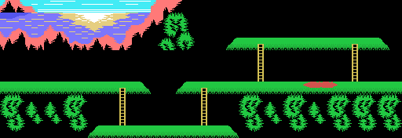
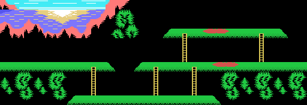
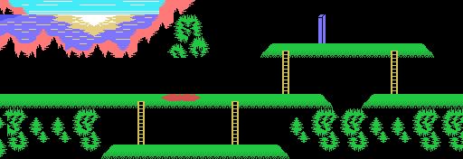
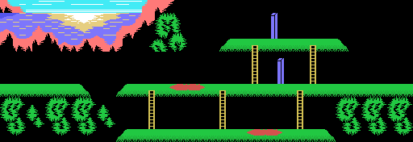
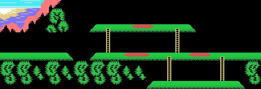
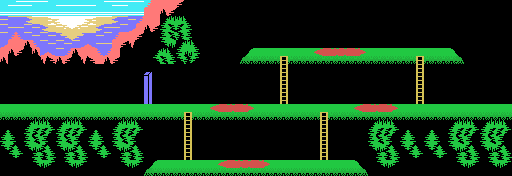
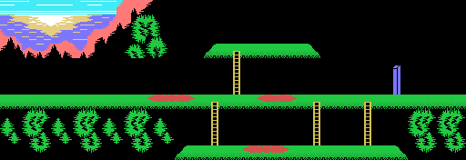
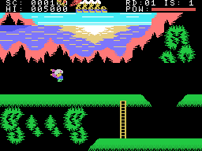
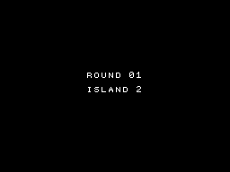

# Las islas

Siete islas, en orden, y después de la séptima la primera de la vuelta siguiente. Cada isla tiene **64 columnas
de ancho**, dos pantallas: el juego la monta entera en la RAM y la pantalla enseña 32 columnas.

## Las siete islas, enteras

No son capturas: son la RAM que monta el juego para cada isla (0xE01A, 24 filas de 64 casillas), como está dos
cuadros después de montarla, antes de que se mueva nada, pintada con las casillas y los colores de la VRAM de ese
mismo cuadro; las 32 columnas que hay en la pantalla en ese momento casan con la tabla de nombres casilla a
casilla (`tools/mapas.py`). Simbad y el pájaro son sprites y no salen. La grabación empieza en la isla 7 con las
teclas 2 y 3 pulsadas al encender ([Curiosidades](CURIOSIDADES.html)); las otras seis las **fuerza** el guion, que
escribe la isla siguiente donde la escribe el juego.

## Cómo se monta una isla

`isla_pon` (0x4B21) desempaqueta las casillas y los colores, llena de blanco los 0x600 bytes de la isla y pone las
piezas de las listas de la isla, cada lista con un bloque por isla acabado en 0 (`lista_isla`, 0x4D6A):

- el **acantilado y el mar** de arriba: ocho filas de un dibujo de 32 columnas (0x54F7), cortado en una columna
  distinta en cada isla (0x5496);
- las **plataformas** (4 x 6 casillas, 0x55F7) y las **escaleras** (3 x 6, 0x560F) de dos listas;
- los dos **huecos** de los suelos (0x5411, cuatro bytes por isla), con sus bordes;
- las escaleras largas (`columnas_pon`, 0x4D43) y los **postes azules** (`cosas4_pon`, 0x4D77), que paran el
  alfanje;
- los **charcos rojos**, de 6 y 7 casillas (`cosas6_pon`, 0x4DF1; `cosas7_pon`, 0x4E21), y más huecos de 8 + 8
  casillas (`cosas8_pon`, 0x4DAE).

La vista sigue a Simbad columna a columna: cuando se acerca a menos de 12 columnas de su borde izquierdo, o de 20
del derecho, el juego la mueve (`bordes`, 0x42F5) y vuelve a mandar las 22 filas a la VRAM (`fondo_pantalla`,
0x5645). En cada cuadro los objetos se dibujan como **casillas** en la RAM de la isla (`pinta_objeto`, 0x767B) y las
18 filas del centro van a la pantalla (`fondo_vram`, 0x4470); solo Simbad, el pájaro y el tiro son sprites.

## Los enemigos

Todos están en una tabla de ocho objetos de 6 bytes (0xEB32), cada uno con su clase (sus dibujos y su tamaño):

| | cuántos | puntos | qué hace |
|---|---|---|---|
| el primero (0xEB32) | 1 | 500 | sale cuando la isla se abre; derribarlo saca la salida |
| los pequeños (0xEB38) | 3 | 100 | andan; donde no pueden seguir, desaparecen (`enemigo_cae`, 0x6BC1) |
| los que abren la isla (0xEB4A) | 3 | 250 | andan; uno de ellos se queda y huye de Simbad (`queda_huye`, 0x78A4) |
| el grande (0xEB5C) | 1 | 500 | una planta que le dispara y cada 120 cuadros salta a otro piso (`grande`, 0x6F61) |

A los que abren la isla hay que derribarlos un número de veces, que el marcador enseña con iconos (0xEB29): **5**
en la isla 1, **6** en la isla 2 y **7** en las demás, en la primera vuelta. Los datos de los enemigos cambian con
la vuelta: la primera y la segunda tienen los suyos, y desde la tercera se turnan los de la tercera y la cuarta
(`vuelta_datos`, 0x6A17).

## La salida y el pájaro

Cuando la cuenta llega a 0 la isla **se abre** (0xE001 bit 0): suena la música de la isla abierta y el primer
objeto aparece junto a la vista. Derribarlo saca la **salida** (0xE001 bit 1): una casilla 0x38 en el sitio de la
lista de la isla (0x5488), o en la isla 7 un dibujo de 3 x 3 casillas que cambia cada 16 cuadros (`marca_isla`,
0x5044). Tocarla acaba la isla (`meta_mira`, 0x6076).

Entonces el pájaro gigante baja sobre Simbad, lo coge y se va volando; se cuenta la fuerza que le queda, 500 puntos
por punto, y sale el cartel de la isla siguiente con el pájaro llevándolo; en la isla, el pájaro baja y lo deja en
la columna 8 (`pajaro_final`, 0x5768; `isla_cuenta`, 0x5812; `pajaro_se_lleva`, 0x56AB; `pajaro_trae`, 0x56DF).
En la grabación de abajo la salida está **forzada**: ningún guion derriba a todos los enemigos, así que el guion
escribe 0xEAE4 = 0xFF, lo que deja Simbad al tocar la salida (0x60A0), y desde ahí el juego sigue solo.

