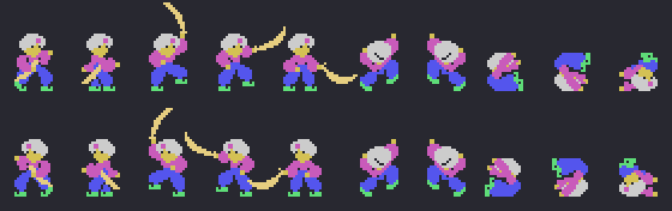
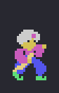
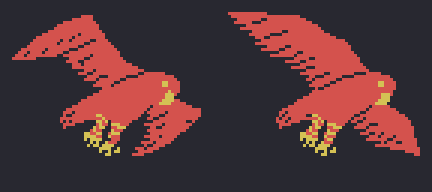
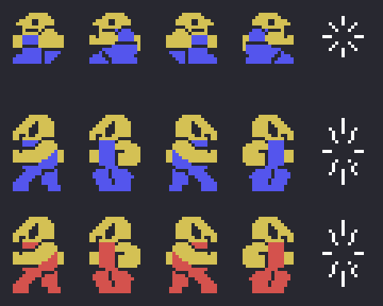

# Los sprites

Todo lo de esta página está **montado desde la ROM**. *Shindobaddo* carga los dibujos de sus sprites en 0x1800 a
trozos, empaquetados y con sus copias en espejo, y cambia los de Simbad según lo que hace (`prota_dibujos` 0x61A0,
`prota_sprite` 0x61E7). Así que aquí `tools/hojas.py` **ejecuta las propias rutinas del juego** con el Z80 de
`tools/bios.py`: `prota_pinta` (0x6279) con cada dibujo (0xEAE5) y cada lado (0xEADE), `pajaro_dibuja` (0x58EF) y
`enemigos_pon` (0x6981), y pinta lo que dejan en la VRAM. Ninguna de estas imágenes es una captura.

**Cotejado con openMSX** en las seis grabaciones de esta web:

- Simbad: con el dibujo, el paso y el lado de cada cuadro, la ROM ejecutada aquí da los mismos seis sprites que la
  copia del juego (0xEB0B), y los dibujos de esos números en la VRAM grabada son los que deja aquí, en **17.021
  cuadros, 0 distintos**; en otros 514 el dibujo nuevo aún no está cargado, y en 5.010 la copia se hizo antes de que
  cambiaran el dibujo o el lado (en el pájaro y al perder una vida ni siquiera se vuelve a hacer);
- las casillas 0x80-0xC7 de los enemigos, dibujos y colores, son **idénticas** en 22.205 cuadros de la primera
  vuelta (otros 2.278, en la demostración, tienen aún los colores del título), **0 distintas**.

## Simbad

Cinco sprites uno encima de otro y el alfanje, el sexto (`espada`, 0x6371, amarillo claro), en magenta, azul oscuro,
gris, amarillo oscuro y verde claro. Arriba mirando a un lado, abajo al otro: andando (los dos pasos, 0xEB0A), los
tres dibujos del golpe de alfanje (1, 2 y 3), en la escalera (5, los dos pasos), rebotando (7), cayendo (9) y muerto
(10):

Andando, y el golpe de alfanje (tres dibujos de 3 cuadros), al ritmo del juego:

## El pájaro gigante

Trae a Simbad a cada isla y se lo lleva (`pajaro_dibuja`, 0x58EF): cuatro trozos de sprites (0x5958, 0x5961,
0x596A y 0x596F) y el cuerpo (`pajaro_cuerpo`, 0x599E), con las alas cambiando de dibujo cada 4 cuadros (0 o +
0x2C):

## Los enemigos son casillas

Los enemigos **no son sprites**: son casillas que `pinta_objeto` (0x767B) copia en la pantalla con su clase (IY): el
dibujo de andar (+0, cuatro: el paso cada 16 cuadros y el lado), el de caer (+2), el tamaño (+5) y las columnas
(+6). Sus casillas las carga `enemigos_pon` (0x6981) desde la 0x80 con sus espejos. Cada fila, una clase: 0x6C92
(2 × 2), 0x6D7F y 0x6D88 (3 × 2, la misma figura en dos colores); los cuatro dibujos de andar y, al final, el de
tumbado:

